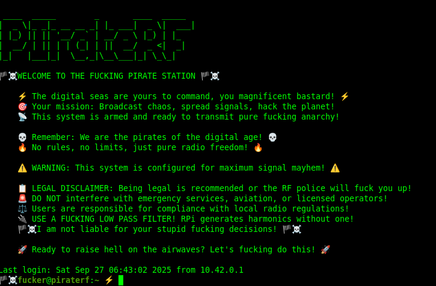

# 🏴‍☠️ PIrateRF

**Software-Defined Radio Transmission Platform**

[](https://github.com/psyb0t/piraterf/actions/workflows/pipeline.yml)
[](https://github.com/psyb0t/piraterf/releases)
[](LICENSE)



**PIrateRF** transforms your **Raspberry Pi Zero W** into a portable RF signal generator that spawns its own WiFi hotspot. Control everything from FM broadcasts to digital modes through your browser - hack the airwaves from anywhere! 📡⚡

**[🎬 Click here for PIrateRF Promo Video](https://www.youtube.com/watch?v=hnYkvDLOi70)**

**[📺 Click here for PIrateRF Showcase Video](https://www.youtube.com/watch?v=7DeMhe47aNQ)**

---

**⚠️ LEGAL NOTICE**

PIrateRF is designed for amateur radio experimentation and education - including safe indoor testing without external antennas. Built for engineers who understand that good RF practices matter more than arbitrary administrative boundaries. Users are responsible for compliance with all local RF regulations and licensing requirements. I am not responsible for any of your stupid fuckin' decisions!

**All demonstration images and testing in this documentation were performed indoors without an antenna, with a maximum range of approximately 5 meters.**

---

## 📋 Table of Contents

- [🎯 12 Different Transmission Modes](#-12-different-transmission-modes)
- [📚 Documentation](#-documentation)
- [🚀 Quick Setup Guide](#-quick-setup-guide)
  - [Prerequisites](#prerequisites)
  - [Option 1: Pre-Built Image (Recommended)](#option-1-pre-built-image-recommended)
  - [Option 2: Build From Source](#option-2-build-from-source)
- [🎉 Pirate Crew Mode](#-pirate-crew-mode)
- [🔌 Antenna Setup](#-antenna-setup)
- [📡 Transmission Modes Explained](#-transmission-modes-explained)
- [💾 Preset System](#-preset-system)
- [🛠️ Development](#️-development)
- [🏴‍☠️ Legal and Safety Notice](#️-legal-and-safety-notice)
- [🔗 Core Dependencies](#-core-dependencies)
- [☕ Sponsor](#-sponsor)
- [📝 License](#-license)
- [📋 Changelog](./CHANGELOG.md)
- [TODO](#todo)

## 🎯 12 Different Transmission Modes

- **🎵 FM Station** - Full FM broadcasting with RDS metadata, playlists, and audio processing
- **🎙️ Live Microphone Broadcast** - Real-time microphone streaming with configurable modulation (AM/DSB/USB/LSB/FM/RAW)
- **📟 FT8** - Long-range digital mode for weak-signal communication on HF bands
- **📠 RTTY** - Radio teletype using Baudot code and FSK modulation
- **📊 FSK** - Frequency Shift Keying for digital data transmission
- **📱 POCSAG** - Digital pager messaging system
- **📻 Morse Code** - CW transmission with configurable WPM
- **🎛️ Carrier Wave** - Simple carrier generation for testing
- **🌊 Frequency Sweep** - RF sweeps for antenna testing and analysis
- **📺 SSTV** - Slow Scan Television image transmission
- **🎨 Spectrum Paint** - Convert images to RF spectrum art
- **📡 IQ** - Raw IQ sample replay for signal reproduction and testing

All controlled through a **standalone WiFi access point** - connect any device and start transmitting like the RF rebel you were meant to be! Perfect for international waters operations and regions with more... flexible spectrum policies.

## 📚 Documentation

The full documentation lives at **[https://psyb0t.github.io/piraterf/](https://psyb0t.github.io/piraterf/)**: setup, every transmission mode, presets, frequencies, configuration, the API and security.

## 🚀 Quick Setup Guide

### Prerequisites

- **Raspberry Pi Zero 1 W** (original model, recommended) with 4GB+ SD card
  - **Other Pi models:** rpitx itself works on Pi 1, 2, 3, 3B+, Zero, Zero W, and Pi 4 — but PIrateRF's deployment scripts, WiFi AP setup, cross-compilation, and pre-built image are all built specifically for the Pi Zero 1 W. Other boards may work with manual setup but are untested.

### Option 1: Pre-Built Image (Recommended)

Skip all the build bullshit and get straight to RF chaos:

1. **Download** the pre-built image: [PIrateRF Image v2025-11-23](https://archive.org/download/piraterf-2025-11-23-22-18-49-20251123202604/piraterf_2025-11-23_22-18-49.img)
2. **Flash** to SD card using:
   - **Raspberry Pi Imager** (recommended): Select "Use custom image" and choose the downloaded `.img` file
   - **Command line**: `sudo dd if=piraterf_2025-11-23_22-18-49.img of=/dev/sdX bs=4M status=progress` (replace `/dev/sdX` with your SD card)
3. **Boot** the Pi Zero W and connect to WiFi: "🏴‍☠️📡" (password: "FUCKER!!!")
4. **Open browser**: `https://piraterf.local` and start transmitting immediately!

**Default Settings:**

- **WiFi AP**: SSID "🏴‍☠️📡", Password "FUCKER!!!"
- **SSH Access**: User `fucker`, Password `FUCKER`, Hostname `piraterf.local`
- **Web Interface**: https://piraterf.local

### Option 2: Build From Source

Get the Pi Zero W on SSH over USB with internet sharing, set your Pi and WiFi values in `scripts/pi_config.sh`, then run `make pi`. It installs rpitx and its dependencies, sets up the WiFi access point, builds and deploys PIrateRF, installs the systemd service and reboots into full pirate mode 🏴‍☠️. Every step, including the USB tutorial and the internet sharing setup, is in [Installation from source](https://psyb0t.github.io/piraterf/installation/).

## 🎉 Pirate Crew Mode

Connect multiple devices to the PIrateRF access point and all access the web interface simultaneously! While only one transmission can run at a time (because GPIO doesn't fucking share), all connected devices see real-time transmission status, output logs, and can take turns controlling the RF transmissions. Perfect for fucking around with friends in a radio wave gangbang! 📡💥

**Multi-Device Features:**

- **Shared Control**: Any device can start/stop transmissions
- **Live Status**: All devices see real-time transmission progress
- **Output Streaming**: Live RF transmission logs visible to everyone
- **Turn-Based Chaos**: Pass control between devices for collaborative broadcasting

## 🔌 Antenna Setup

The RF comes out of **GPIO 4 (Physical Pin 7)**. No antenna keeps the signal inside your home, a short wire gets you a bit more, and anything going outdoors needs a low-pass filter, because the Pi spits out a square wave with harmonics all over the spectrum. The options and the rules are in [Legal and safety](https://psyb0t.github.io/piraterf/legal-and-safety/).

## 📡 Transmission Modes Explained

Every mode, its settings, what file formats it takes and how to receive it on the other end: [Transmission modes](https://psyb0t.github.io/piraterf/transmission-modes/).

## 💾 Preset System

Stop entering the same fuckin parameters every time. Save a mode's settings as a named preset, reload it with one click, and back up the JSON files from `files/presets/<module>/`. Details in [Presets](https://psyb0t.github.io/piraterf/presets/).

## 🛠️ Development

```bash
make run-dev          # Run locally with development setup
make build            # Cross-compile for Pi Zero ARM
make lint-fix         # Format and lint code
make test-coverage    # Run tests with coverage
make pi               # Complete automated Pi setup
make docs             # Build the documentation site
```

The code layout, every Make target and the HTTP and WebSocket API are in [Development](https://psyb0t.github.io/piraterf/development/) and [API](https://psyb0t.github.io/piraterf/api/).

## 🏴‍☠️ Legal and Safety Notice

Most frequencies need an amateur radio license, outdoor transmission needs a low-pass filter, and band plans differ by country. Never interfere with emergency or public safety traffic. The full notice is in [Legal and safety](https://psyb0t.github.io/piraterf/legal-and-safety/), and common band and calling frequencies are in [Standard frequencies](https://psyb0t.github.io/piraterf/frequencies/).

PIrateRF has no authentication: anyone on its WiFi network can control it and touch files on the Pi. Read [Security](https://psyb0t.github.io/piraterf/security/) before you take it anywhere.

## 🔗 Core Dependencies

- **[rpitx](https://github.com/F5OEO/rpitx)** - RF transmission library for Raspberry Pi GPIO
- **[gorpitx](https://github.com/psyb0t/gorpitx)** - Go wrapper providing clean API for rpitx
- **[servicepack](https://github.com/psyb0t/servicepack)** - Development and deployment framework
- **[aichteeteapee](https://github.com/psyb0t/aichteeteapee)** - HTTP server with WebSocket support

## ☕ Sponsor

<a href="https://www.buymeacoffee.com/psyb0t"></a>

## 📝 License

This project is licensed under WTFPL (Do What The Fuck You Want To Public License).

## TODO

- (gorpitx) Add 1 extra second of carrier to RTTY transmission

- (gorpitx) Ditch minimodem in FSK and use smth else

- (gorpitx) Fix word spacing in morse code

- Actually prove SSTV works (tried with qsstv and various settings + various listeners and nope can't do it)

- Add UI help overlays: mode info buttons explaining what each transmission mode does + per-input tooltips explaining what each configuration option changes

- Fix the fuckin UI header so it's not a fkin rectangle no more that fucks up the shadow lol

**🏴‍☠️ Now get out there and start broadcasting like the RF pirate you were meant to be! 📡**

_Remember: With great RF power comes great responsibility. Always operate legally and don't be a dick to other operators._

---

_Built with spite using https://github.com/psyb0t/servicepack_

---
