# Transmission modes

PIrateRF has 12 transmission modes. You pick one from the dropdown in the web UI, fill in its settings and press start. Each mode maps to one [gorpitx](https://github.com/psyb0t/gorpitx) module, which runs the matching rpitx program. The module name is what the [WebSocket API](api.md) takes as `moduleName`, and what the [preset](presets.md) directory is named after.

| Mode | Module | Frequency unit |
| --- | --- | --- |
| [FM Station](#fm-station) | `pifmrds` | MHz |
| [Live Microphone Broadcast](#live-microphone-broadcast) | `audiosock-broadcast` | Hz |
| [FT8](#ft8) | `pift8` | Hz |
| [RTTY](#rtty) | `pirtty` | Hz |
| [FSK](#fsk) | `fsk` | Hz |
| [POCSAG](#pocsag) | `pocsag` | Hz |
| [Morse Code](#morse-code) | `morse` | Hz |
| [Carrier Wave](#carrier-wave) | `tune` | Hz |
| [Frequency Sweep](#frequency-sweep) | `pichirp` | Hz |
| [SSTV](#sstv) | `pisstv` | Hz |
| [Spectrum Paint](#spectrum-paint) | `spectrumpaint` | Hz |
| [IQ](#iq) | `sendiq` | Hz |

Every module accepts frequencies from 5 kHz to 1500 MHz and rejects anything outside that range before rpitx starts. Only one transmission runs at a time; starting a second one while the first is running gets an "execution already in progress" error.

The decoder commands below use `pw-record --target=81` to capture the audio your SDR program plays. `81` is the PipeWire node ID of the monitor of your audio output on my machine; find yours with `wpctl status` and use that number instead.

{: .note }
All demonstration screenshots were taken indoors without an antenna, with a range of about 5 meters.

## FM Station

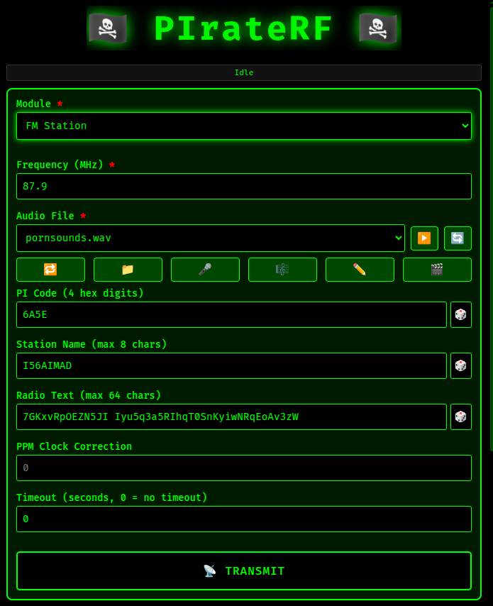

Full FM broadcasting with RDS.

**Settings:**

- **Frequency**: carrier frequency in **MHz**, with 0.1 MHz precision (for example `87.9`).
- **Audio file**: upload a file or pick one already on the Pi. Uploads in MP3, M4A, FLAC, OGG, AAC, WMA, WAV or WebM are converted with FFmpeg to 48 kHz, 16-bit, mono WAV in `files/audio/uploads/`, and the original is deleted.
- **Playlist builder**: combines several audio files and sound effects into one WAV with Sox.
- **RDS**:
  - **PI code**: 4 hexadecimal digits, the station ID radios use internally.
  - **PS name**: station name, up to 8 characters.
  - **Radio text**: scrolling message, up to 64 characters.
- **Play mode**: "play once" or "loop". Play once measures the audio with Sox, adds 2 seconds of silence at the end and stops after the audio, or after the timeout when that is shorter.
- **Intro and outro**: sound effects played before and after the main audio. PIrateRF joins them into a temporary WAV in `/tmp` and deletes it when the transmission ends.
- **PPM clock correction**: compensates for the Pi's oscillator error.
- **Timeout**: stops the transmission after this many seconds. The field starts at `0`, which means no timeout; an empty field means 30 seconds.
- **Microphone recording**: records audio in the browser and uploads it as a WAV.

**Reception:**

- **Demodulation**: WFM (wideband FM).
- **Signal**: the waterfall shows the main signal with the audio and two parallel RDS signals at a fixed offset from the carrier.
- **RDS decoding**: SDR++ (the sdrpp-brown fork) has a built-in RDS decoder that shows the PI code, PS name and radio text, no plugins needed.

**Applications:** underground radio, music streaming, podcasting, community radio, pirate radio stations, rickrolling entire neighborhoods.

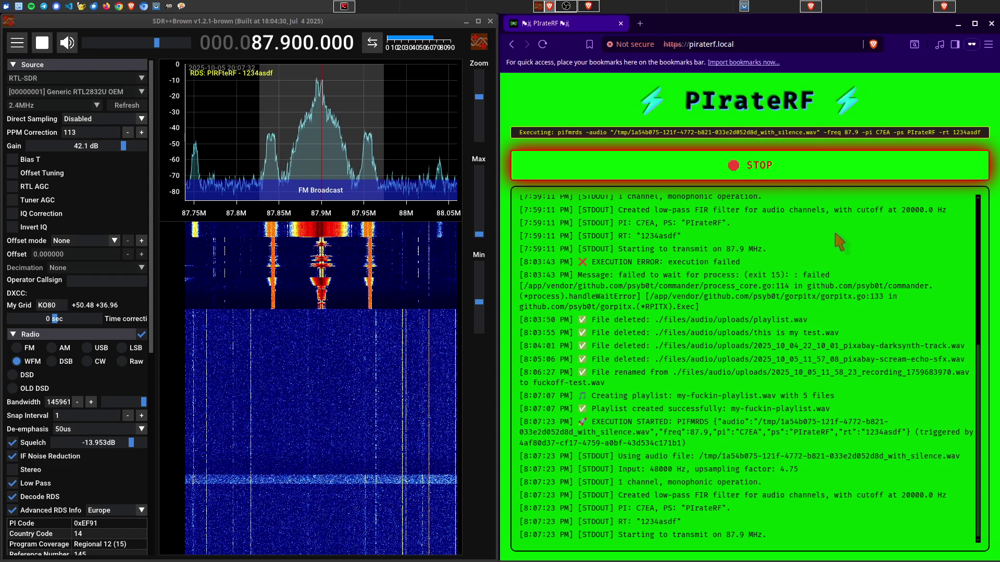

## Live Microphone Broadcast

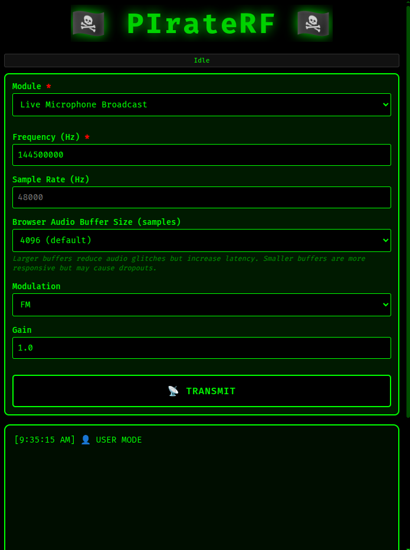

Real-time microphone streaming with a choice of modulation.

**Settings:**

- **Frequency**: carrier frequency in Hz.
- **Sample rate**: audio sample rate, default 48000 Hz.
- **Buffer size**: browser audio buffer in samples:
  - 1024: low latency, may glitch.
  - 2048: balanced.
  - 4096: the default.
  - 8192: higher quality, higher latency.
  - 16384: best quality, highest latency.
- **Modulation**: AM, DSB, USB, LSB, FM (default) or RAW. USB and LSB are slow on the Pi Zero.
- **Gain**: audio gain multiplier, default 1.0.

The browser captures the microphone and streams it over the `/wsunix` WebSocket, which PIrateRF bridges into a unix socket that rpitx reads. Browsers only allow microphone access on HTTPS pages, so open the UI over `https://`. The broadcast runs until you stop it.

**Reception:**

- **Demodulation**: the same mode you transmit with (AM, DSB, USB, LSB, FM or RAW).

**Applications:** live commentary, emergency communications, amateur radio nets, real-time broadcasting, broadcasting your burps, going live on radio from the moshpit.

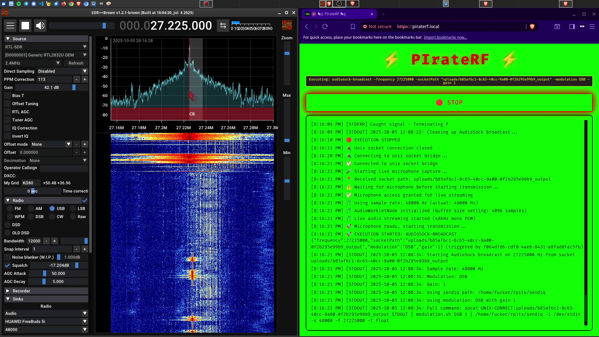

## FT8

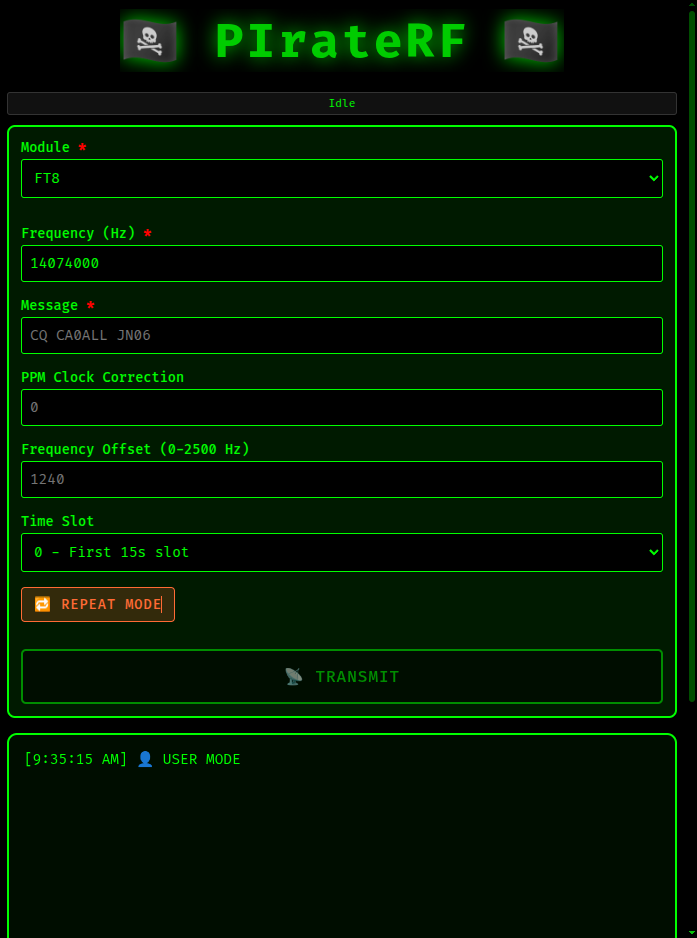

Weak-signal digital mode for long-distance HF contacts.

**Settings:**

- **Frequency**: base frequency in Hz (for example `14074000` for 20 m).
- **Message**: the FT8 message text (for example `CQ CA0ALL JN06`).
- **PPM clock correction**: optional; without it rpitx adjusts automatically from NTP.
- **Frequency offset**: 0 to 2500 Hz within the FT8 sub-band, default 1240.
- **Time slot**: `0` transmits in the first 15-second slot, `1` in the second, `2` in every slot. Default `0`.
- **Repeat mode**: keeps transmitting every cycle instead of once.

**Reception:**

- **Demodulation**: USB.
- **Decoding**: SDR++ (sdrpp-brown fork) has a built-in FT8 decoder module that works when tuned to a standard FT8 frequency such as 14.074 MHz.

{: .warning }
Do not transmit FT8 without your own amateur radio call sign. FT8 messages carry call signs, and sending one that is not yours is call sign spoofing and illegal.

**Applications:** long-distance contacts, weak-signal work, intercontinental contacts, confusing the fuck out of contesters.

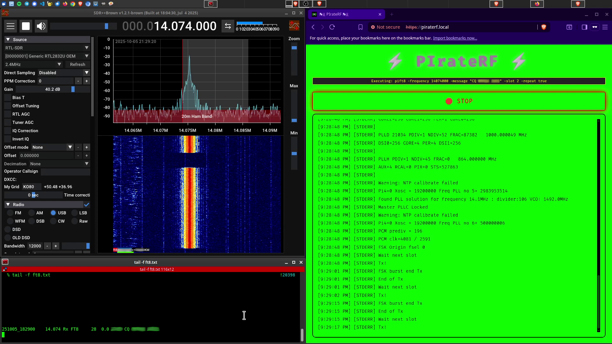

## RTTY

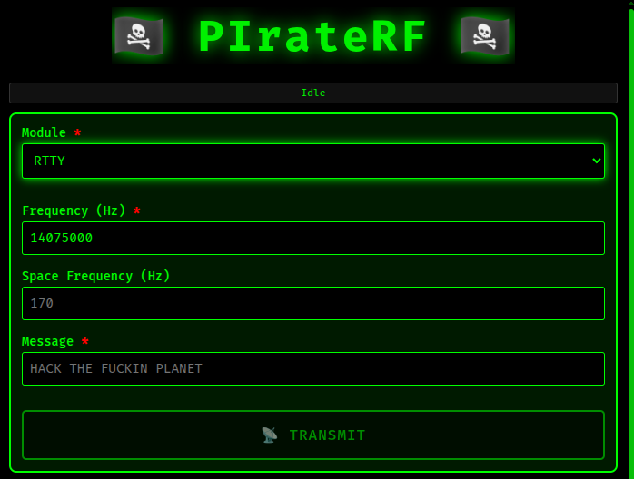

Classic radio teletype text.

**Settings:**

- **Frequency**: carrier frequency in Hz.
- **Space frequency**: space tone offset in Hz, default 170. The mark tone sits 170 Hz above it.
- **Message**: the text to send.

**Reception:**

- **Demodulation**: USB.
- **Decoding with fldigi**:
  - Set fldigi to RTTY mode.
  - Set the shift to match your space frequency (45.45 baud and 170 Hz by default).
  - Point fldigi's audio input at the PulseAudio or PipeWire monitor of your SDR program's output (SDR++, GQRX, SDRSharp, SDRAngel and so on).

**Applications:** digital text, news bulletins, teletype messages, sending ASCII art over RTTY.

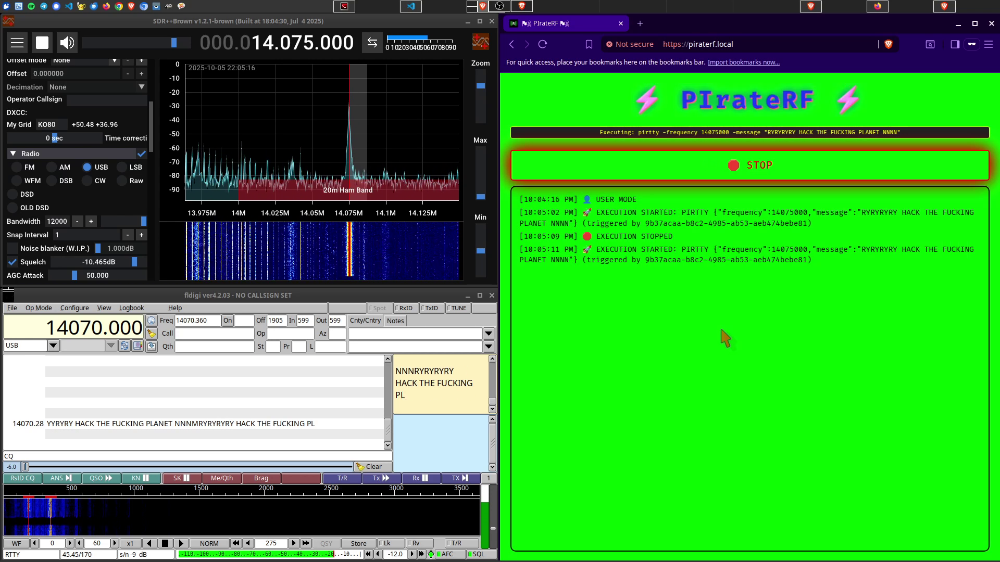

## FSK

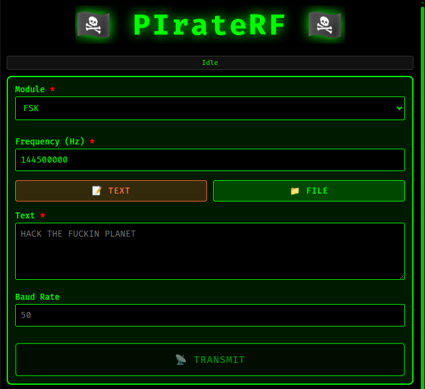

Binary frequency shift keying for text or files.

**Settings:**

- **Frequency**: carrier frequency in Hz.
- **Input type**:
  - **Text**: type the text to send.
  - **File**: upload any file. It is moved unchanged, extension included, to `files/data/uploads/`.
- **Baud rate**: default 50 baud, the most reliable in my tests.

**Reception:**

- **Demodulation**: FM.
- **Decoding with minimodem**, with `--rx` set to your baud rate:

  ```bash
  pw-record \
    --target=81 \
    --rate=48000 \
    --channels=1 \
    - | minimodem --rx 50 -q -c 1
  ```

  It works best at 50 to 100 baud.

**Applications:** digital bulletins, file transfer, packet radio, amateur digital modes, sending porn like back in the dialup days.

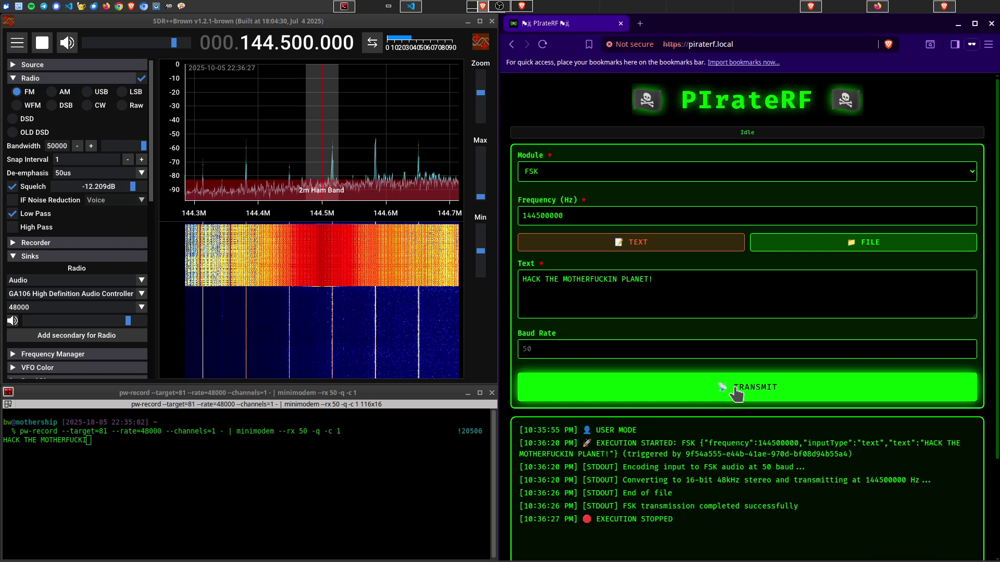

## POCSAG

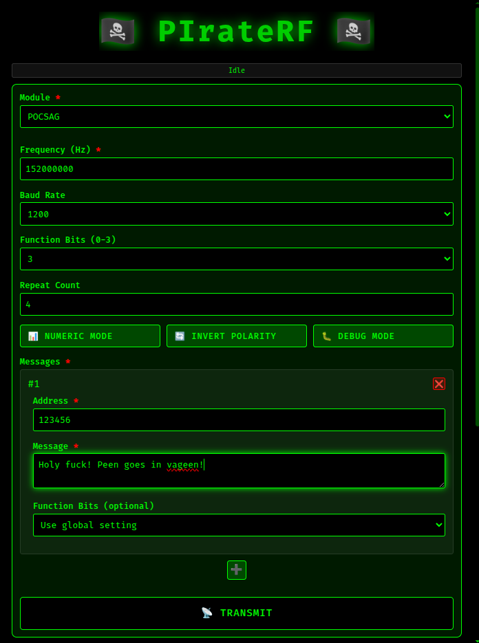

Pager messages.

**Settings:**

- **Frequency**: carrier frequency in Hz.
- **Baud rate**: 512, 1200 (default) or 2400.
- **Function bits**: 0 to 3, default 3:
  - 0: numeric-only messages (BCD encoded).
  - 1 and 2: ring only; what the pager does depends on its settings.
  - 3: alphanumeric messages (ASCII encoded).
- **Repeat count**: how many times to send, default 4.
- **Numeric mode**: send numeric-only messages.
- **Invert polarity**: invert the signal.
- **Debug mode**: print debug output.
- **Messages**: one or more entries, each with:
  - **Address**: pager address, a non-negative integer.
  - **Message**: the text.
  - **Function bits** (optional): overrides the global value for this message.

**Reception:**

- **Demodulation**: FM.
- **Decoding with multimon-ng**:

  ```bash
  pw-record \
    --target=81 \
    --rate=22050 \
    --channels=1 \
    - | multimon-ng -t raw -a POCSAG1200 -
  ```

  Match the multimon-ng mode to the baud rate: `-a POCSAG512`, `-a POCSAG1200` or `-a POCSAG2400`.

**Applications:** paging systems, alert notifications, mass notification chaos, 90s nostalgia bombing.

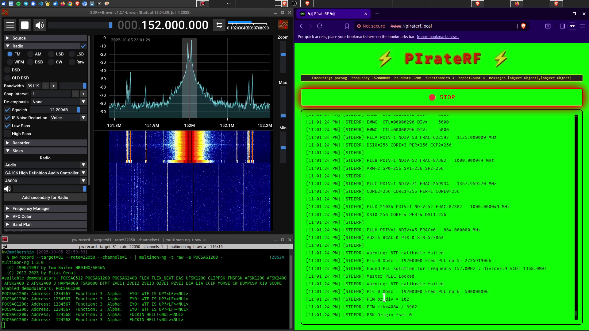

## Morse Code

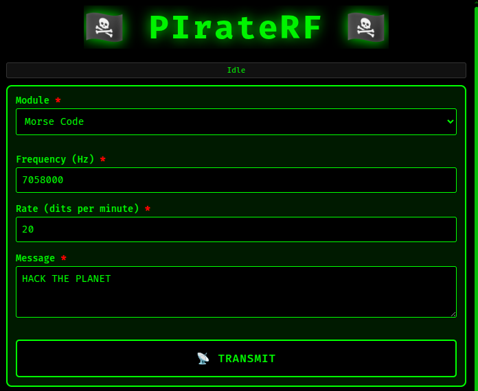

CW transmission.

**Settings:**

- **Frequency**: carrier frequency in Hz.
- **Rate**: speed in dits per minute, default 20.
- **Message**: the text to key.

**Reception:**

- **Demodulation**: CW.
- **Decoding with multimon-ng**:

  ```bash
  pw-record \
    --target=81 \
    --rate=22050 \
    --channels=1 \
    - | multimon-ng -t raw -a MORSE_CW -d 60 -g 60 -
  ```

  Tune `-d` (delay) and `-g` (gain) to your rate: faster keying needs a lower delay, slower keying a higher one.

**Applications:** Morse practice, beacons, emergency communications, sending dirty messages in CW, beacon spam.

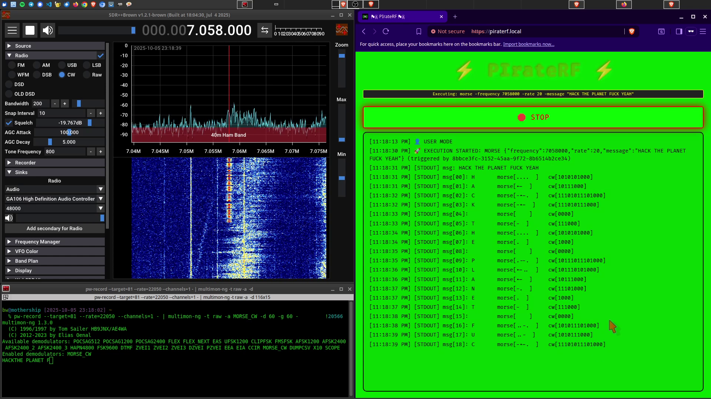

## Carrier Wave

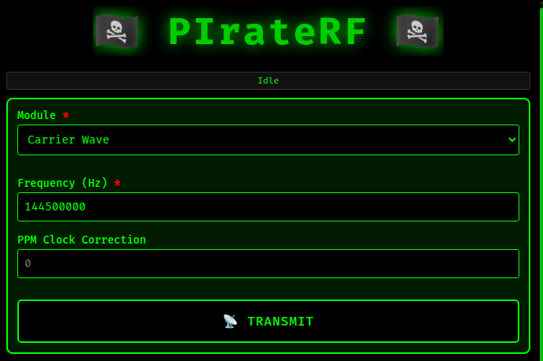

A plain carrier for testing.

**Settings:**

- **Frequency**: carrier frequency in Hz.
- **PPM clock correction**: compensates for the Pi's oscillator error.

**Reception:**

- **Demodulation**: RAW.
- **Signal**: a continuous wave at the set frequency.

**Applications:** antenna tuning, transmitter testing, SWR measurements, dead carrier trolling, RF circuit testing.

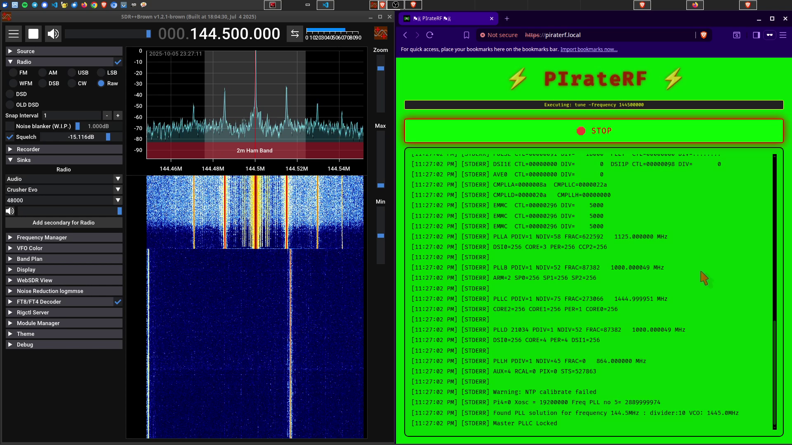

## Frequency Sweep

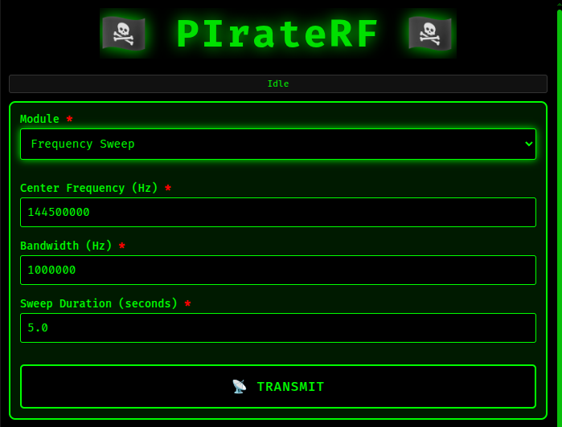

A carrier that sweeps across a band.

**Settings:**

- **Center frequency**: in Hz.
- **Bandwidth**: sweep width in Hz, default 1 MHz.
- **Sweep duration**: seconds per full sweep, default 5.0.

**Reception:**

- **Demodulation**: RAW.
- **Watch**: the carrier moves left to right across your waterfall.

**Applications:** antenna analysis, filter testing, frequency response measurements, wobbulating like a maniac, antenna torture testing.

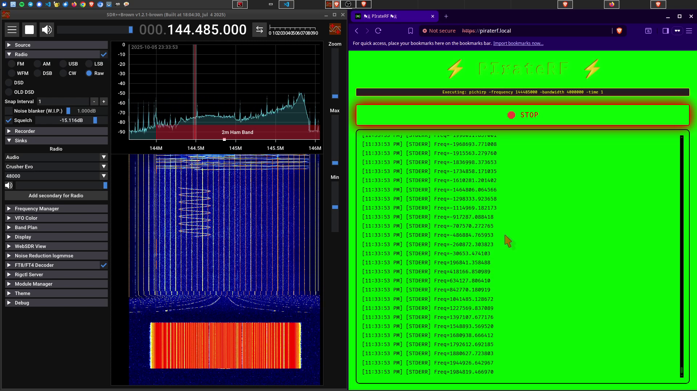

## SSTV

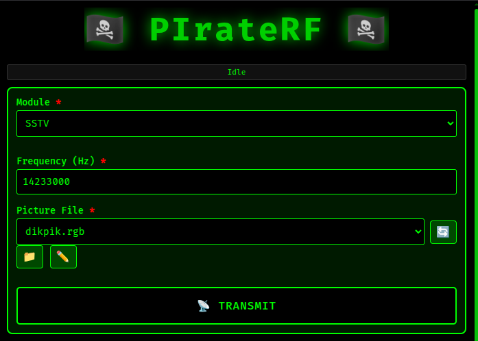

Slow Scan Television pictures.

**Settings:**

- **Frequency**: carrier frequency in Hz.
- **Picture file**: upload an image or pick one already on the Pi. See [image uploads](#image-uploads).

**Reception:**

- **Demodulation**: USB.
- **SSTV mode**: Martin 1.
- **Decoding**: QSSTV or other SSTV software.

{: .warning }
**Unverified.** I have tried decoding this with QSSTV and have not received a picture yet. I trust the rpitx SSTV module to generate proper Martin 1 signals. If you decode an SSTV transmission from PIrateRF, please [open an issue](https://github.com/psyb0t/piraterf/issues) describing your setup and how you decoded it.

**Applications:** pictures over radio, amateur SSTV, visual communication, cock pic broadcasting (look at that big ass rooster).

## Spectrum Paint

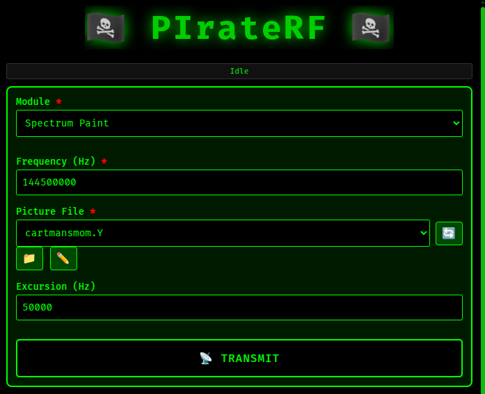

Draws an image on the waterfall.

**Settings:**

- **Frequency**: base frequency in Hz.
- **Picture file**: upload an image or pick one already on the Pi. See [image uploads](#image-uploads).
- **Excursion**: frequency deviation in Hz, default 100000.

**Reception:**

- **Demodulation**: RAW.
- **Waterfall**: set the waterfall to full resolution with no filtering, so it shows all peaks and not just the strongest, to see the whole picture.

**Applications:** RF spectrum art, spectrum visualization, signal analysis demos, drawing dick pics on waterfalls, spectrum graffiti.

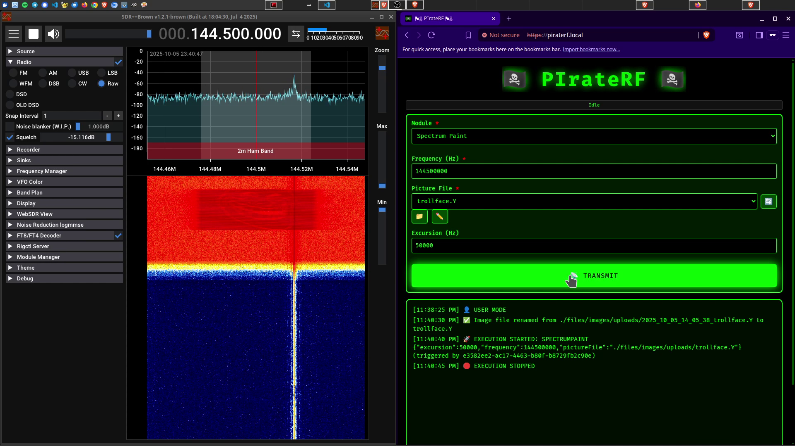

## Image uploads

SSTV and Spectrum Paint share one upload path. An image uploaded from either mode in JPG, JPEG, PNG, BMP, GIF, TIFF or WebP is converted with ImageMagick into two files in `files/images/uploads/`, and the original is deleted:

- a `.Y` file (320 pixels wide, flipped, quantized to 4 YUV colors) for Spectrum Paint,
- a `.rgb` file (raw 8-bit RGB, forced to exactly 320x256) for SSTV.

So an image uploaded once can be used by both modes.

## IQ

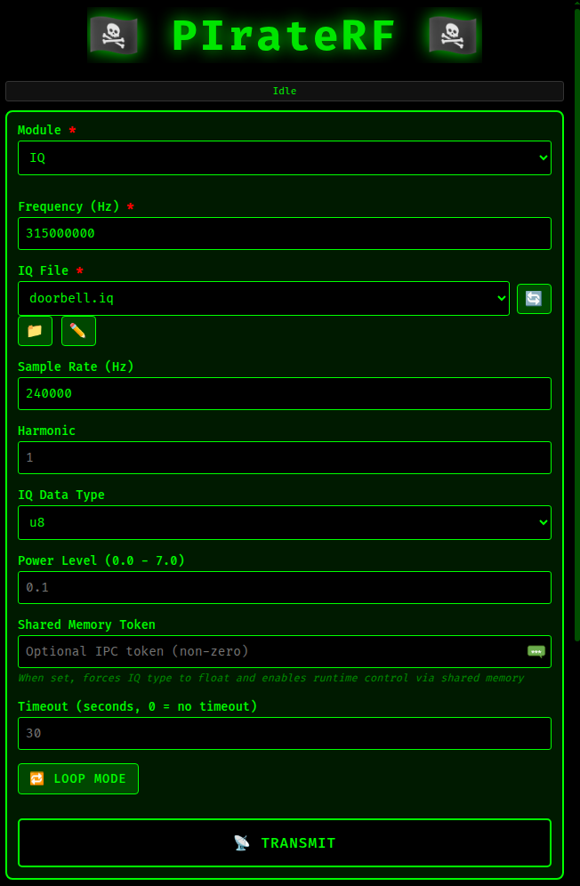

Replays a file of raw IQ samples.

**Settings:**

- **Frequency**: carrier frequency in Hz.
- **IQ file**: upload a `.iq` file or pick one already on the Pi. Uploads are moved unchanged to `files/iqs/uploads/`.
- **Sample rate**: in Hz, default 48000. Valid from 10000 to 2000000; rpitx decimates anything above 200000 automatically.
- **Harmonic**: harmonic number to transmit on, default 1.
- **IQ data type**: `u8`, `i16` (default), `float` or `double`.
- **Power level**: drive level from 0.0 to 7.0, default 0.1.
- **Shared memory token**: optional IPC token for runtime control. Setting it forces the IQ type to `float`.
- **Timeout**: stops the transmission after this many seconds. The field starts at `0`, which means no timeout; an empty field means 30 seconds.
- **Loop mode**: replays the file continuously.

**Reception:**

- **Demodulation**: whatever the captured signal used. IQ files hold raw I/Q samples, so they can carry any modulation, and the replay reproduces the captured signal.

**Applications:** signal replay, repeater capture and replay, testing and validation, signal analysis, reproducing complex modulations, SDR capture replay, RF fingerprinting research.
